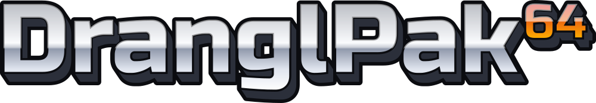
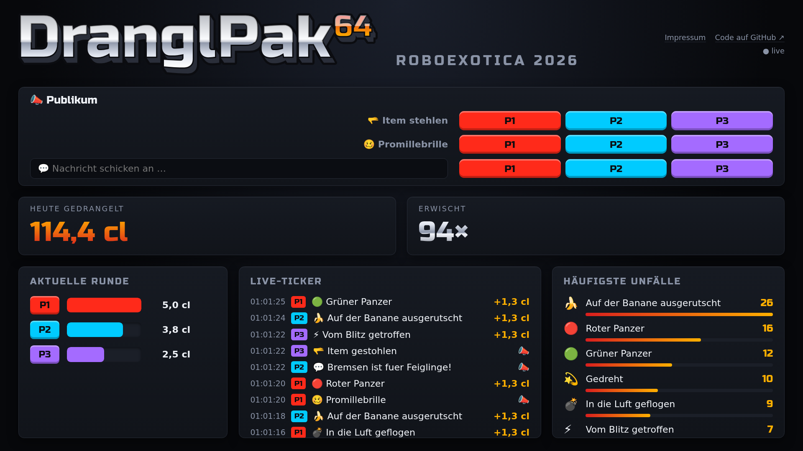

<p align="center">
  
</p>

<p align="center">
  <b>The Rumble Pak's boozy cousin.</b><br>
  Get hit in kart racing on the Nintendo 64 – and a shot goes straight into your mouth.<br>
  <i>Built for Roboexotica 2026, Vienna.</i>
</p>

---

## What is it?

The **DranglPak64** is a box you plug into a Nintendo 64. Up to four players race
or battle as usual – each with a silicone tube in their mouth. Every time
something hits you – a banana peel, a red shell, a truck, a bomb, a lightning
bolt – the box switches on *your* pump and *drangelt* a shot straight into your
mouth. No hands needed: they're busy with the controller anyway.

For hygiene, every tube ends in a replaceable paper mouthpiece.

No buttons to press, no referee: the game itself tells the box exactly who just
got hit by what.

## How it works

```
 ┌───────────┐     ┌──────────────┐ USB ┌──────────────────┐ GPIO ┌─────────┐
 │ Nintendo  │◀───▶│ SummerCart64 │◀───▶│  Raspberry Pi 4B │─────▶│  pumps  │──▶ 👄
 │    64     │     │  flash cart  │     │     (NixOS)      │      │ (P1–P8) │
 └───────────┘     └──────────────┘     └──────────────────┘      └─────────┘
   runs nk64          IS-Viewer +         drink-dispenser.py
                      USB debug link
```

1. **The game snitches.** The N64 runs [nk64](https://github.com/knedlsepp/nk64),
   a fork of the [Mario Kart 64 decompilation](https://github.com/n64decomp/mk64).
   At every mishap it prints a line of JSON, e.g.
   `{"event":"hit_red_shell", "playerIndex":1}`, into the
   [SummerCart64](https://github.com/Polprzewodnikowy/SummerCart64)'s IS-Viewer buffer.
2. **The Pi listens.** On boot the Raspberry Pi uploads the ROM to the cart and keeps
   `sc64deployer debug` running, which streams those lines over USB.
3. **The pump pours.** [`drink-dispenser.py`](drink-dispenser.py) turns each event into
   0.3 s of suspense followed by 1.5 s of pumping on the player's GPIO pin. Hits in quick
   succession extend the pour instead of restarting it.

With pumps doing 500 ml/min, a hit is worth about **1.25 cl**.

### What pours

| | |
|---|---|
| 🍌 Banana | 🟢 🔴 🔵 Green, red and blue shell |
| ⚡ Lightning | ⭐ Run over by a star |
| 💣 Bombs (bomb karts, eliminated battle players) | ❓ Fake item box |
| 🚚 🚗 🚌 🚂 Trucks, cars, school bus, train | ⛄ Snowman · ⛓️ Chain chomp · 🕳️ Moles |
| 🌋 🌊 Lava and water | 🥞 Squished · 🚢 Paddle boat |
| 💫 Spinning out | 🚦 Jumping the start |

### Priming the tubes

Press **L + R + Z** on the title screen: the pumps run for as long as you hold them, so the
silicone tubes are filled before the first race. (In nk64 this is the "negroni code".)

## Hardware

| Part | Price | |
|---|---:|---|
| Nintendo 64 | priceless | with up to four controllers |
| [Mcbazel N64 HDMI adapter](https://www.amazon.de/dp/B0BXH2J7C8) | €15.99 | for a modern TV or screen, 480p/720p |
| [SummerCart64](https://github.com/Polprzewodnikowy/SummerCart64) | €36.85 | flash cart, connected to the Pi via USB |
| Raspberry Pi 4B | 50€ (2025 😢) | running NixOS |
| [Waveshare 8-ch Relay Expansion Board](https://de.aliexpress.com/item/32952644654.html) | €26.99 | on top of the Pi: a relay per player |
| 4× G928 12 V peristaltic pump | €120.68 | one per player, 500 ml/min |
| 12 V power supply | | for the pumps, and the Pi via the step-down converter |
| [Greluma 12 V to 5 V converter](https://www.amazon.de/dp/B0BX3MQ18D) | €9.06 | 5 V/3 A on USB-C: powers the Pi from the 12 V |
| WAGO 221-413 terminals, 3-pole (12 pieces) | €8.02 | for the wiring |
| WAGO 221-415 terminals, 5-pole (8 pieces) | €7.04 | for the wiring |
| Speaker cable, 2 × 2.5 mm², 10 m | €8.20 | for the wiring |
| Blade connectors, 2.8 mm, 1.5–2.5 mm² (50 pieces) | €4.99 | for the pumps' terminals |
| iMeistek silicone hose, 6 mm ID × 9 mm OD, food grade, 6 m | €12.10 | with a replaceable paper mouthpiece |
| Vicloon paper straws, 6 mm (pack of 100) | €8.05 | the replaceable mouthpieces, stuck into the hose |
| 90° hose connectors, 6 mm (pack of 6) | €4.99 | for the hoses |
| Cable ties, 80 × 1.8 mm (300 pieces) | €5.57 | |
| [Rittal KX 1555.000 E-Box](https://www.automation24.at/e-box-rittal-kx-1555-000-300-x-300-x-120) | €52.90 | 300 × 300 × 120 mm, IP66, with mounting plate: houses it all |
| [HangTon USB-C panel mount](https://www.amazon.de/dp/B0CDPSGBNL) | | waterproof (IP65) pass-through in the cabinet wall |
| USB-C to USB-C cable, 0.3 m (pack of 2) | €6.04 | short cables inside the cabinet |
| USB-A to USB-C cable, 20 cm | €5.53 | short cable inside the cabinet |
| **Parts listed with a price** | **€333.00** | |

The relay board switches its relays with these GPIOs (active low), which is what
[`drink-dispenser.py`](drink-dispenser.py) drives:

| Player | P1 | P2 | P3 | P4 | P5 | P6 | P7 | P8 |
|--------|----|----|----|----|----|----|----|----|
| GPIO   | 5  | 6  | 13 | 16 | 19 | 20 | 21 | 26 |

(The game has at most four human players, so four pumps are enough.)

## The audience joins in

The Pi also serves a **live dashboard** – on a big screen at the booth, on the
visitors' phones via its own WiFi hotspot `DranglPak64`, and online at
**[dranglpak64.knedlsepp.at](https://dranglpak64.knedlsepp.at)**. Everyone watching can
steal a player's item, put the drunk goggles on them (tunnel vision for a few seconds)
or send a message right onto their screen – all harmless on purpose: none pours a drink.

<p align="center">
  
</p>

## Setup

Everything is one NixOS flake: the system, the ROM (built from nk64) and the services.

**Flash the SD card**

```sh
nix build .#images.dranglpak64
zstdcat result/sd-image/nixos-sd-image-*.img.zst | sudo dd of=/dev/mmcblk0 status=progress bs=4096 conv=fsync
```

**Update over the air** (the Pi is reachable as `dranglpak64.local`)

```sh
nixos-rebuild --target-host root@dranglpak64.local --flake ./. switch
```

> [!WARNING]
> A new ROM gets uploaded while the old one is running, which crashes the game.
> Switch the N64 off and on again afterwards.

Secrets (WiFi, Cloudflare tunnel) are [agenix](https://github.com/ryantm/agenix)-encrypted
in [`secrets/`](secrets), see [`secrets.nix`](secrets.nix).

## What's in here

| | |
|---|---|
| [`drink-dispenser.py`](drink-dispenser.py) | Game events → pumps |
| [`configuration.nix`](configuration.nix) | The Pi: ROM upload, services, hotspot, tunnel |
| [`dashboard.py`](dashboard.py), [`web/`](web) | The live dashboard |
| [`swag/`](swag) | Stickers and T-shirt, generated by `make_swag.py` |
| [`overlays/`](overlays) | `sc64deployer` and the nk64 ROM as Nix packages |

## Credits

- [Mario Kart 64 decompilation](https://github.com/n64decomp/mk64) by the n64decomp
  contributors – nk64 builds on it
- [SummerCart64](https://github.com/Polprzewodnikowy/SummerCart64) by Polprzewodnikowy
- [Russo One](https://fonts.google.com/specimen/Russo+One) font, SIL Open Font License

Not affiliated with or endorsed by Nintendo. You need your own copy of the game to build
the ROM.

**Please drink responsibly.** 🍹
